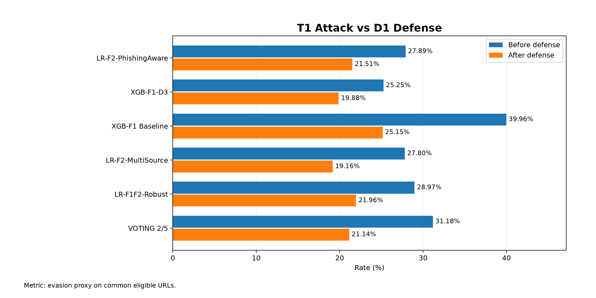
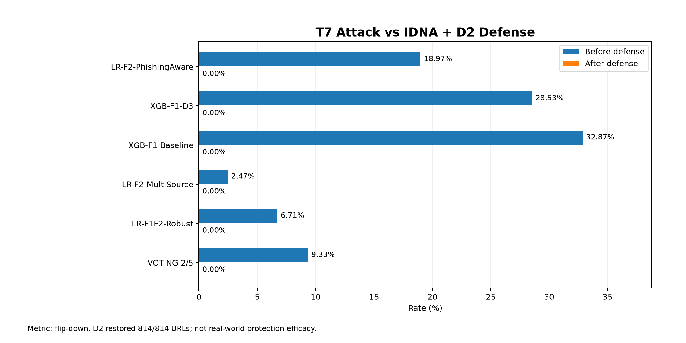
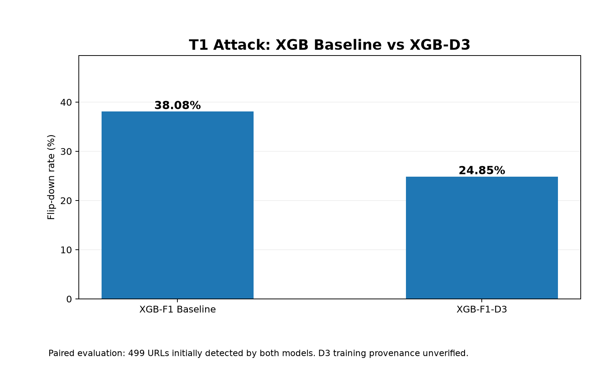

# AIC211 - Attack & Defend Research Findings

Date: 2026-10-27
Research branch: research/attack-defense

## 1. Summary

| Experiment | Metric | Eligible URLs | Before | After |
|---|---|---:|---:|---:|
| T1 vs D1 | Evasion proxy | 667 | 31.18% | 21.14% |
| T7 vs D2 | Flip-down rate | 504 | 9.33% | 0.00% |

## 2. D1 and D2 - Detailed Results

| Experiment | Model | Metric | Eligible | Before | After |
|---|---|---|---:|---:|---:|
| T1_D1 | LR-F2-PhishingAware | evasion_proxy | 502 | 27.89% | 21.51% |
| T1_D1 | XGB-F1-D3 | evasion_proxy | 503 | 25.25% | 19.88% |
| T1_D1 | XGB-F1 Baseline | evasion_proxy | 513 | 39.96% | 25.15% |
| T1_D1 | LR-F2-MultiSource | evasion_proxy | 428 | 27.80% | 19.16% |
| T1_D1 | LR-F1F2-Robust | evasion_proxy | 428 | 28.97% | 21.96% |
| T1_D1 | VOTING 2/5 | evasion_proxy | 667 | 31.18% | 21.14% |
| T7_D2 | LR-F2-PhishingAware | flip_down | 348 | 18.97% | 0.00% |
| T7_D2 | XGB-F1-D3 | flip_down | 354 | 28.53% | 0.00% |
| T7_D2 | XGB-F1 Baseline | flip_down | 359 | 32.87% | 0.00% |
| T7_D2 | LR-F2-MultiSource | flip_down | 283 | 2.47% | 0.00% |
| T7_D2 | LR-F1F2-Robust | flip_down | 283 | 6.71% | 0.00% |
| T7_D2 | VOTING 2/5 | flip_down | 504 | 9.33% | 0.00% |

## 3. D3 - Paired XGBoost Comparison

| Model | Common detected | Lost alerts | Flip-down | Paired wins |
|---|---:|---:|---:|---:|
| XGB-F1 Baseline | 499 | 190 | 38.08% | 6 |
| XGB-F1-D3 | 499 | 124 | 24.85% | 72 |

## 4. Experimental Method

- Data: test_A.csv, 1,000 sampled malicious URLs, random seed 42.
- T1/D1: Compare original and T1-transformed URLs with and without canonicalization.
- T7/D2: Compare original and homoglyph/Punycode-transformed URLs using IDNA decoding and homoglyph normalization.
- D3: Compare XGB-F1 Baseline and XGB-F1-D3 on the same 499 initially detected URLs.
- Website voting rule: suspicious when at least 2 of 5 models flag the URL.

## 5. FPR Observations

- Earlier terminal tests on 1,000 benign URLs reported voting FPR = 2.60% before and after D1.
- The same benign sample reported voting FPR = 2.60% before and after D2.
- D2 changed 0 of those 1,000 benign URLs.
- These FPR observations need reproducible row-level logs before final reporting.

## 6. Limitations

- T1 evasion results assume the modified URL retains the malicious behavior of the original.
- T7 can change the actual registered domain; a changed domain does not automatically retain its original label.
- IDNA + D2 restored 814/814 evaluated T7 URLs exactly. This explains the 0% flip-down result but does not establish real-world protection effectiveness.
- The provenance and training data of xgb_f1_d3.joblib have not been independently verified.
- D1, D2 and D3 results use different eligible samples and must not be directly ranked as equivalent metrics.
- The experiments do not establish that the five-model website can safely classify every URL.

## 7. Research Status and Remaining Work

### Completed

1. Evaluated T1 attack against D1 canonicalization.
2. Evaluated T7 attack against D2 homoglyph normalization.
3. Compared XGB-F1 Baseline and XGB-F1-D3 on paired T1 samples.
4. Exported reproducible per-URL evaluation results for D1, D2, and D3.
5. Prepared three comparison figures and a research findings report.

### Remaining Work

1. Verify the training provenance of XGB-F1-D3.
2. Evaluate false positives on benign Unicode/Punycode URLs.
3. Prepare final presentation tables and research conclusions.
## 8. Research Figures

### Figure 1. T1 Attack vs D1 Defense

*Figure 1. Evasion proxy before and after D1 canonicalization.*

### Figure 2. T7 Attack vs D2 Defense

*Figure 2. Flip-down rate before and after IDNA decoding and D2 normalization. Restoring URL strings does not establish real-world attack prevention.*

### Figure 3. XGBoost Baseline vs D3

*Figure 3. Paired T1 evaluation on 499 commonly detected URLs. D3 training provenance remains unverified.*

## 9. Reproducibility

### 9.1. Experimental Setup

The experiments were performed using Python on the
research/attack-defense Git branch.

Required resources:
- Dataset: data/processed/handoff/test_A.csv
- Five trained machine learning models
- Attack and Defense source code

The experiments sampled 1,000 malicious URLs using
random seed 42.

### 9.2. Reproduction Commands

Run these commands from the repository root:

    python -m src.evaluation.export_d1_t1_rows
    python -m src.evaluation.export_d2_t7_rows
    python -m src.evaluation.export_d3_t1_rows

Use the Python environment with the required dependencies
installed.

Before rerunning, back up existing row-level CSV outputs
because the scripts do not overwrite them.

### 9.3. Expected Experimental Results

| Experiment | Eligible URLs | Before | After |
|---|---:|---:|---:|
| T1 - D1 (Voting 2/5) | 667 | 31.18% | 21.14% |
| T7 - D2 (Voting 2/5) | 504 | 9.33% | 0.00% |
| T1 - D3 (XGBoost comparison) | 499 | 38.08% | 24.85% |

**Interpretation note:** For T1-D1 and T7-D2, "Before" and
"After" indicate results before and after URL normalization.

For T1-D3, 38.08% represents XGB-F1 Baseline, while
24.85% represents XGB-F1-D3. These are two different
models evaluated on the same 499 initially detected URLs,
not one model measured before and after preprocessing.

### 9.4. Research Data

Detailed results are stored locally:

- reports/d1_t1_row_level_20261027.csv
- reports/d2_t7_row_level_20261027.csv
- reports/d3_t1_row_level_20261027.csv

These files contain per-sample prediction results.
They should not be published without reviewing
potential data privacy and reconstruction risks.

### 9.5. Experimental Limitations

- D1 measures changes in detection after URL canonicalization.
- D2 restored 814 evaluated transformed URL strings,
  but this does not prove real-world phishing prevention.
- D3 showed lower T1 flip-down rates than XGB-F1 Baseline
  on the same 499 initially detected URLs.
- The training provenance of XGB-F1-D3 remains unverified.
- D1, D2, and D3 use different eligible samples and
  should not be directly ranked against each other.
- The experiments analyze URL strings without visiting
  the websites.